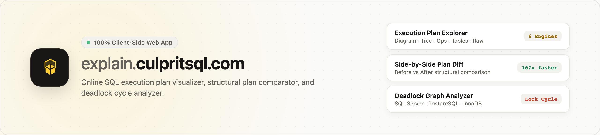
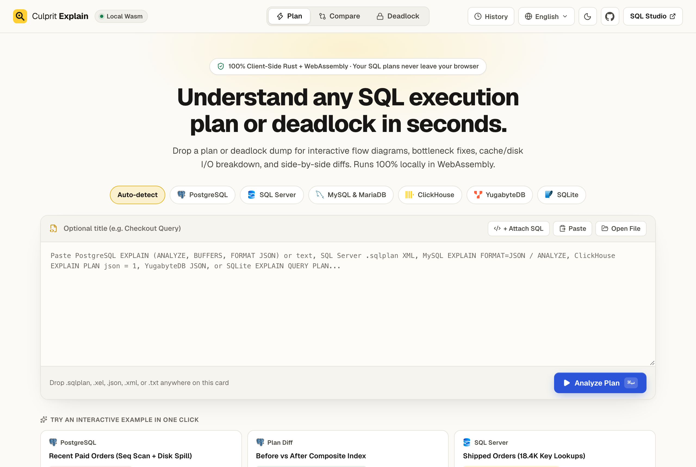

<div align="center">

<picture>
  <source media="(prefers-color-scheme: dark)" srcset="https://raw.githubusercontent.com/culpritsql/culprit-explain/main/assets/hero-dark.png">
  <source media="(prefers-color-scheme: light)" srcset="https://raw.githubusercontent.com/culpritsql/culprit-explain/main/assets/hero-light.png">
  
</picture>

<br />

[](https://explain.culpritsql.com)
[](https://www.npmjs.com/package/@culpritsql/plans)
[](https://www.npmjs.com/package/@culpritsql/plan-viewer)
[](#privacy--security)
[](./LICENSE)

**Free client-side SQL execution plan visualizer, structural plan comparator, deadlock cycle analyzer, and Extended Events (`.xel`) inspector.**
<br />
Powered by [`@culpritsql/plans`](https://github.com/culpritsql/culprit-plans) (Rust + WebAssembly) and [`@culpritsql/plan-viewer`](https://github.com/culpritsql/culprit-plan-viewer) (React).

[Features](#features) · [Supported Engines](#supported-engines) · [Privacy & Security](#privacy--security) · [Local Development](#local-development)

</div>

---

<picture>
  <source media="(prefers-color-scheme: dark)" srcset="https://raw.githubusercontent.com/culpritsql/culprit-explain/main/assets/preview-studio-dark.png">
  <source media="(prefers-color-scheme: light)" srcset="https://raw.githubusercontent.com/culpritsql/culprit-explain/main/assets/preview-studio-light.png">
  
</picture>

---

## Features

- **100% local in WebAssembly**: Execution plans, SQL statements, and deadlock dumps are parsed inside your browser tab and never uploaded to any server.
- **Five synchronized plan views**: Interactive flow **Diagram** (pan, cursor-anchored zoom, minimap, `Time` / `Cost` / `Rows` / `Reads` metric lens, step search), **Tree**, **Operations**, **Tables**, and **Raw** output.
- **Side-by-side plan comparison**: Structural `Before` vs `After` diffing with measured speedup ratios, access-path flip badges, and root-cause explanations.
- **Deadlock cycle graphs & Extended Events (`.xel`)**: Interactive lock-wait SVG diagrams, victim rollback badges, and remediation SQL for SQL Server, PostgreSQL, and MySQL InnoDB, plus binary SQL Server Extended Events (`.xel`) and exported XML inspection directly in the browser without Windows SSMS.
- **Serverless sharing & redaction**: Compress plans into `#s=...` URL fragments (which browsers never transmit over HTTP) with one-click SQL literal redaction, or export standalone HTML and Markdown reports.

---

## Supported Engines

| Engine | Execution Plans | Deadlocks |
| --- | --- | --- |
| **PostgreSQL & TimescaleDB** | `EXPLAIN (FORMAT JSON)`, `EXPLAIN (ANALYZE, BUFFERS)` text | Server log deadlock excerpts |
| **SQL Server & Azure SQL** | `.sqlplan` Showplan XML | Binary `.xel` Extended Events, XML deadlock graphs (`.xdl` / `.xml`) |
| **MySQL & MariaDB** | `EXPLAIN FORMAT=JSON`, `EXPLAIN ANALYZE` tree text | `SHOW ENGINE INNODB STATUS` |
| **ClickHouse** | `EXPLAIN PLAN json = 1` physical step tree | Not applicable |
| **YugabyteDB** | `EXPLAIN (ANALYZE, DIST, FORMAT JSON)` + DocDB metrics | PostgreSQL-compatible logs |
| **SQLite** | `EXPLAIN QUERY PLAN` text | Not applicable |

---

## Privacy & Security

- **Strict Content Security Policy**: Enforced CSP restricting scripts and network calls strictly to local WebAssembly assets and cookie-free Plausible pageview analytics; SQL plans and queries never leave your browser.
- **Text-only DOM rendering**: Identifiers, predicates, and SQL statements render strictly as React text nodes (never `dangerouslySetInnerHTML`).
- **Bounded parser ceilings**: XML `<!DOCTYPE>` and entity expansions are rejected; deep inputs run on a dedicated 32 MiB Wasm linear stack.

---

## Local Development

```sh
bun install
bun run dev
```

Build the production static bundle and pre-rendered SEO routes (`dist/`):

```sh
bun run build
```

## License

MIT. Part of [Culprit SQL Studio](https://culpritsql.com).
